# ER-диаграмма

```mermaid
erDiagram
    USERS ||--o{ BOOKINGS : "жасайды"
    BUILDINGS ||--o{ ROOMS : "қамтиды"
    ROOMS ||--o{ BOOKINGS : "брондалады"

    USERS {
        int id PK
        varchar full_name
        varchar email UK
        varchar password_hash
        enum role
        varchar phone
        datetime created_at
    }
    BUILDINGS {
        int id PK
        varchar name
        varchar address
    }
    ROOMS {
        int id PK
        int building_id FK
        varchar room_number
        int floor
        int capacity
        decimal price_per_month
        enum status
    }
    BOOKINGS {
        int id PK
        int user_id FK
        int room_id FK
        date start_date
        date end_date
        enum status
        text comment
        datetime created_at
    }
```

## Кестелер

- **users** – пайдаланушылар (студент, әкімші)
- **buildings** – жатақхана ғимараттары
- **rooms** – бөлмелер, әрқайсысы бір ғимаратқа тиесілі
- **bookings** – брондау өтінімдері

## Байланыстар

- Бір ғимаратта көп бөлме бар (1 : N)
- Бір пайдаланушы көп брондау жасай алады (1 : N)
- Бір бөлме көп рет брондалуы мүмкін (1 : N)
